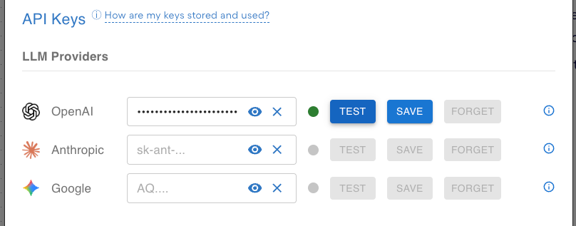
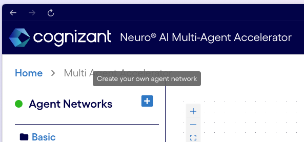
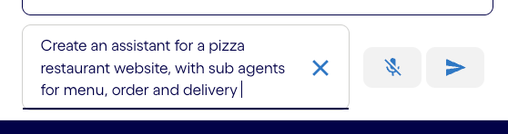
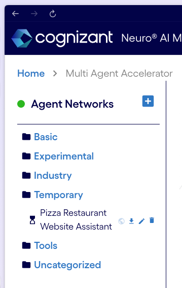
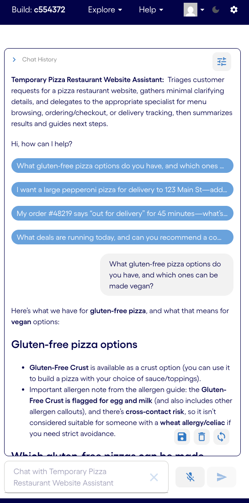
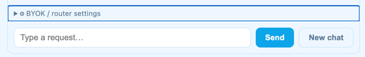
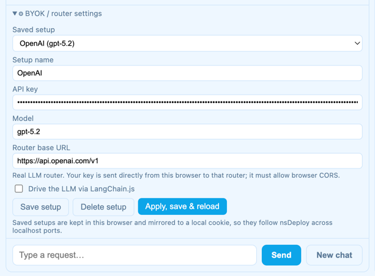
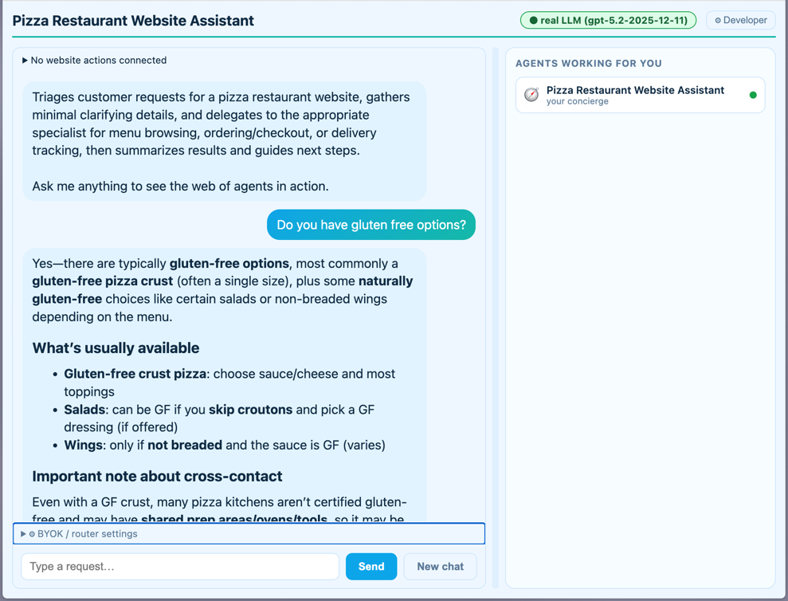

# The Open Agentic Web

Create, own and connect agents on today's web.


## Why

Today, personal AI agents are largely confined to the platforms that build and operate them.
Without open standards, the emerging agent economy risks reproducing the closed ecosystems of
today's internet, where access, visibility and interoperability are controlled by a handful of
companies.

The Open Agentic Web aims to change that. Its vision is a web where people and organizations
can choose their agents, businesses can make their services discoverable to any agent,
and agents can work across platforms regardless of who built them.


## What

An open agentic website is a public website that contains:
- a publicly accessible `.json` file that describes an agent network and its capabilities
- a `runtime.js` file that can run the agent network in the browser
- an interface that allows users to interact with the agent network
- an interface that allows users to configure the LLM and keys to use

### Key principles

- Agent networks are described in **JSON**, a human-readable **configuration** format. Not code.
- Agent networks are **executed in the browser**, without any specific server-side code.
- Users have control over which LLM providers and keys to use, so that the site host **does not pay for LLM calls**.
- Users have control over which sites they visit and which agents they interact with.
- Agent networks can reference other agent networks by URL, allowing them to call and interact with each other.
- Agent networks can call MCP and WebMCP tools

### Existing web infrastructure

Open agentic websites use ordinary web technologies (HTML, CSS, JavaScript, JSON), HTTPS hosting, CORS, WebMCP, MCP and standard web browsers. They are compatible with existing web infrastructure and can be deployed on any public hosting service.


## Examples

The operator of a pizza restaurant wants to agentify their website so that:
- customers can interactively ask questions about the menu. For instance:
  - "What are the vegetarian options?"
  - "I'm lactose intolerant, what can I eat?"
- customers can interactively place orders and choose delivery options. The website can
 delegate the delivery task to other delivery agentic websites.
- other agentic websites can send requests like:
  - "I'm organizing a hackathon and want to order 10 pizzas for delivery at 6pm. Can you help me?"
  - "What's the status for order #12345?"

The LLM provider, model and key used to answer these questions are chosen by the user, not the pizza restaurant. The pizza restaurant does not pay for LLM calls.

## Quickstart

### Generate a website with Neuro SAN and a major LLM provider API key

Quickly prototype an agent network using the
[Neuro SAN BYOK](https://neuro-san.evolution.ml/multiAgentAccelerator?) service.

1. In the settings (top right corner), select your LLM provider and enter your API key.
Test and Save.  

2. Back to the main page, click the blue "+" button to create a new agent network.  

3. In the bottom right corner, type in your prompt and click the blue "Send" arrow button. For instance:  
```prompt
Create an assistant for a pizza restaurant website, with sub agents for menu, order and delivery
```  
  
The agent network designer will create an agent network and come back with
a proposed design and a few sample queries.
4. Click on the generated agent network that appears in the left panel menu as
a "Temporary" agent network to interact with it.
It will be available for 3 days before it is automatically deleted.  

6. The agents are not grounded yet, but you can test the agent network by typing in queries and clicking the blue "Send" arrow button.  

7. Update the design as needed: click the `Edit this network` `🖊️` icon next to the
agent network name under "Temporary" in the left panel menu.
Then use the "NETWORK EDITOR" prompt at the bottom of the screen,
below the agent network graph to tell the agent network designer what to change.
Once satisfied, click the "Download network
definition" icon `⤓` next to the agent network, 
This will download the `.hocon` file describing the agent network.
See [examples/pizza_restaurant_website_assistant.hocon](examples/pizza_restaurant_website_assistant.hocon) for an example.
8. Click the "Download website bundle" icon `⤓` next to the agent network to download a zip file containing the website bundle.  
> [!NOTE]
> TODO: Use manual mode for now

### Manually generate a website bundle

> [!NOTE]
> TODO: validate hocon file before generating website bundle

You can use [nsdeploy](https://github.com/cognizant-ai-lab/nsdeploy) to generate
a website bundle from a `.hocon` file describing an agent network.

1. Install [nsdeploy](https://github.com/cognizant-ai-lab/nsdeploy#install--run)  
```shell
pip install nsdeploy
```
2. Create a self-contained static bundle  
```shell
python -m nsdeploy examples/pizza_restaurant_website_assistant.hocon \
  --static-bundle --out ./dist/pizza
```
3. Check the output of the command, especially for warnings about DEMO-MODE agents (ungrounded agents) and omitted server tools.
4. Preview the generated bundle with an ordinary static web server, for instance:
```shell
python -m http.server 8080 --directory ./dist/pizza
```
Then open http://127.0.0.1:8080/.

### Test with your own LLM provider API key

A configuration panel and a chat interface are available at the bottom of
the generated web page.




#### BYOK (Bring Your Own Key) / router settings

Expand the `⚙ BYOK / router settings` panel and set your API key, Model and
OpenAI compatible endpoint URL.    
For instance:
- API key: `*****`
- Model: `gpt-5.2`
- Route base URL: `https://api.openai.com/v1`

Then click the `Apply, save & reload` button.



#### Chat interface

You can now type a request in the chat interface and click the `Send` button.  
For instance:
```prompt
Do you have gluten free options?
```
And the agent network will respond to your request.  
> [!NOTE]
> Remember, your agent is not grounded yet, so it will make things up!



#### Make it useful

Now that you have all the building blocks, go ahead and make your agent network useful! Happy hacking!

## Building

### Auto generated agentic websites

#### With Neuro SAN

website  
ground  
validate  
nsdeploy  

libraries  
skills  

#### From scratch

Manual edit -> hocon ref
Generate hocon

### Agentifying an existing website

### Infrastructure

Build tools and infrastructure for the agentic web: what will simplify the creation, deployment, and discovery of agentic websites? What will make them more useful?


## Starter tools

These optional tools can help you get started quickly with building agentic web applications.

### NANDA’s Index agent registry

[Nanda Index](https://nandaindex.org/) lets agents find and verify one another across the network. Use it to find other agents, register your own agents, and verify the authenticity of agents you interact with.

### Cognizant AI Lab’s Neuro SAN

[Neuro SAN Studio](https://github.com/cognizant-ai-lab/neuro-san-studio) is an open-source framework
for building and orchestrating multi-agent systems.
Try the [hosted version](https://neuro-san.evolution.ml/) with your own LLM keys. Use it to quickly prototype and test your agent networks.

### Mozilla’s Otari

[Otari](https://otari.ai) is an open-source LLM gateway. Use it to manage your LLM keys and connect to multiple LLM providers.


## Testing


## Documentation

### HOCON reference

### Spec

## Hackathon

See [hackathon.md](hackathon.md) for ongoing hackathons to build the first open agentic websites.

## Ideas

Discuss ideas for agentic web applications in the [Agentic Web Ideas](https://github.com/cognizant-ai-labs/agentic-web/discussions/categories/ideas) discussion category.

## FAQ
